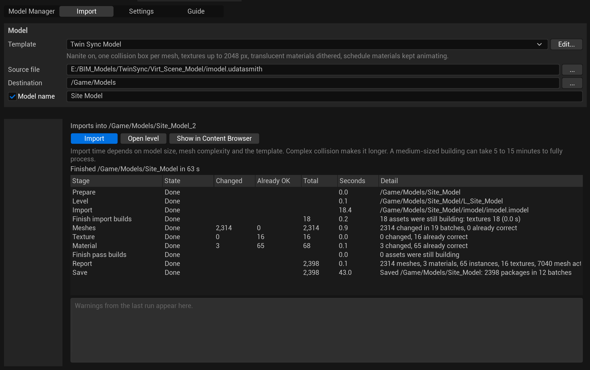
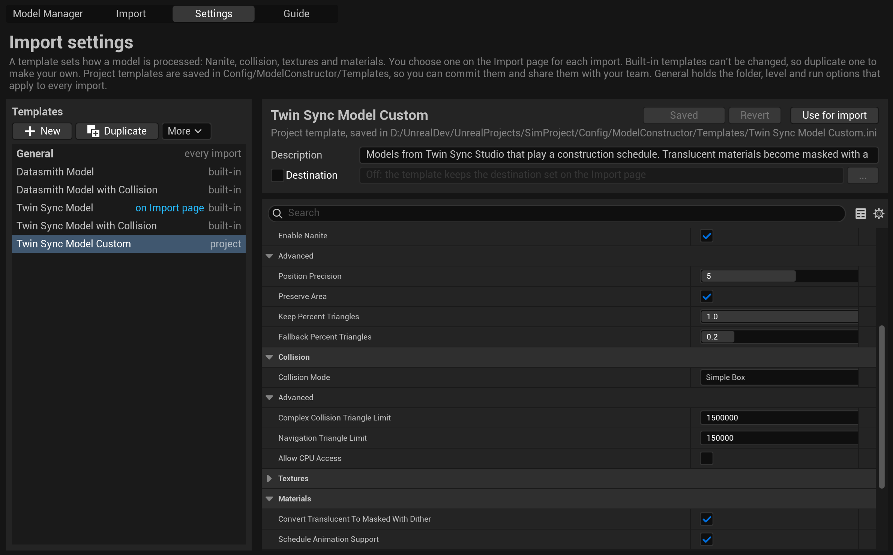
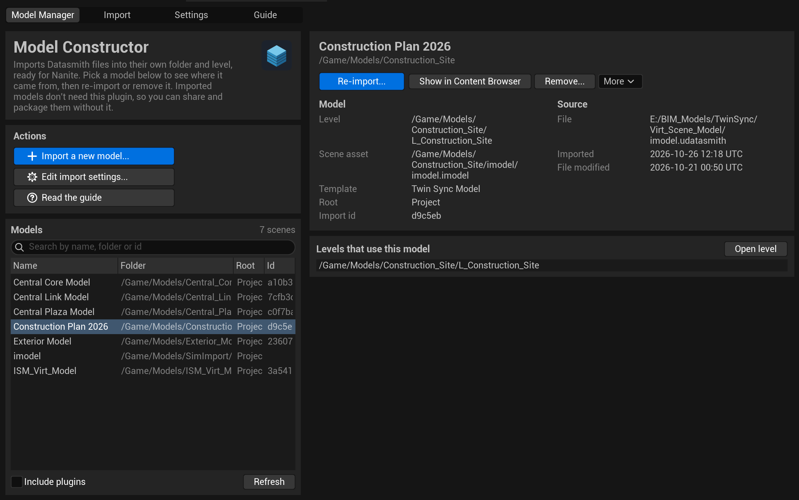
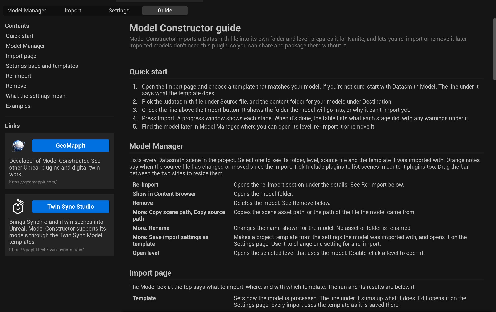

<p align="center">
  
</p>

<h1 align="center">Model Constructor</h1>

<p align="center">
  Datasmith import and model preparation tools for Unreal Engine, for BIM and Twin Sync workflows.
</p>

<p align="center">
  
  
  
  
  
</p>

---

Model Constructor imports a Datasmith file into its own folder and level, prepares it for Nanite, and lets you re-import or remove it later. It is built for building and infrastructure models exported to Datasmith from BIM and design tools, including scenes from Twin Sync Studio, where one model can hold thousands of meshes.

Imported models don't need this plugin. You can share, package or ship them without it.



## Contents

- [What it does](#what-it-does)
- [Requirements](#requirements)
- [Install](#install)
- [Quick start](#quick-start)
- [Templates](#templates)
- [What an import does](#what-an-import-does)
- [Import times](#import-times)
- [Re-import and remove](#re-import-and-remove)
- [Twin Sync models](#twin-sync-models)
- [Python and Blueprint](#python-and-blueprint)
- [Documentation](#documentation)
- [Limitations](#limitations)
- [Support](#support)
- [License](#license)

## What it does

| | |
|---|---|
| **One folder and level per model** | Each import gets its own content folder and level, so models stay separate and can be streamed into a persistent level |
| **Nanite ready** | Turns on Nanite for every mesh and sets the build settings in one pass, with no Dataprep recipe to maintain |
| **Templates** | Four built-in templates cover common cases. Duplicate one to make your own, and commit it so your team imports the same way |
| **Collision** | One box per mesh for light models, or collision on the real surface for walkthroughs and measuring |
| **Materials and textures** | Caps texture size, turns glass into a dithered mask that Nanite can draw, and marks materials for Nanite so packaged builds show them |
| **Large models** | Works in batches and waits for each one, so memory stays steady on models with tens of thousands of actors |
| **Model Manager** | Lists every model with its source file, template and level, and notes when the source has changed since the import |
| **Re-import and remove** | Replace a model with a fresh import at the same paths, or delete it and only the assets its import made |
| **Results you can check** | Every stage reports what changed, what was already correct and how long it took, with warnings for anything worth a look |

## Requirements

| | |
|---|---|
| Unreal Engine | 5.4 to 5.8 |
| Platform | Windows |
| Engine plugins | Datasmith Content and Datasmith Importer. Model Constructor turns them on for you |
| Compiler | The plugin ships as source and is built for your engine version on first use. Install Visual Studio 2022 with the **Game development with C++** workload. Blueprint-only projects work too: the editor offers to build the plugin when you open the project |

## Install

Model Constructor works as a project plugin or as an engine plugin. Use one or the other, not both: two copies of the same plugin conflict.

### As a project plugin

Best for one project, or a team that shares the project in source control.

1. Close the editor.
2. Put the plugin in your project's `Plugins` folder:

   ```
   git clone https://github.com/Geomappit/ModelConstructor.git Plugins/ModelConstructor
   ```

   Or download the release zip and extract it so that `Plugins/ModelConstructor/ModelConstructor.uplugin` exists.
3. Open the `.uproject`. When the editor says modules are missing or were built with a different engine version, choose **Yes** to build them. In a C++ project you can build from your IDE instead.
4. Open the tool from the **Model Constructor** toolbar button, or **Tools > Model Constructor**.

### As an engine plugin

Best when you want the tool in every project on one engine install. An engine installed from the Epic Games Launcher does not build source plugins in its own folder, so build the plugin once per engine version, then copy the result in:

1. Build a packaged copy, replacing the engine and folder paths with your own:

   ```
   "C:\Program Files\Epic Games\UE_5.6\Engine\Build\BatchFiles\RunUAT.bat" BuildPlugin -Plugin="C:\Path\To\ModelConstructor\ModelConstructor.uplugin" -Package="C:\Temp\ModelConstructor_5.6" -TargetPlatforms=Win64
   ```

2. Copy the contents of `C:\Temp\ModelConstructor_5.6` to `C:\Program Files\Epic Games\UE_5.6\Engine\Plugins\Marketplace\ModelConstructor`.
3. In each project that should use it, open **Edit > Plugins**, find **Model Constructor**, tick **Enabled** and restart the editor.

Repeat for each engine version you use. With an engine built from source, you can put the plugin straight into `Engine/Plugins` and build the engine as usual.

The tool has four pages:

| Page | What it is for |
|---|---|
| Model Manager | Find a model, see where it came from, open its level, re-import it or remove it |
| Import | Choose a template, a file and a folder, then import |
| Settings | View, duplicate and edit templates, and the General options |
| Guide | How each page works, what every setting means, and examples |

## Quick start

1. Open the **Import** page and choose a template. If you're not sure, start with **Datasmith Model**. The line under it says what the template does.
2. Pick the `.udatasmith` file under **Source file**, and the folder for your models under **Destination**, for example `/Game/Models`.
3. Check the line above the **Import** button. It shows the folder the model will go into, or why it can't import yet.
4. Press **Import**. A progress window shows each stage and has a Cancel button.
5. When it's done, the results table lists what each stage did, with any warnings under it. Find the model later in **Model Manager**.

## Templates

A template holds the import, Nanite, collision, texture and material settings, and can also set the destination folder.

| Template | Use it for | Collision | Translucent materials | Schedule materials |
|---|---|---|---|---|
| **Datasmith Model** | Design review, flythroughs, stills, clicking objects for details | One box per mesh | Kept as they are | Not handled |
| **Datasmith Model with Collision** | Walkthroughs and measuring against the real surface | Real surface | Kept as they are | Not handled |
| **Twin Sync Model** | Construction schedule playback | One box per mesh | Masked with a dither | Keep animating |
| **Twin Sync Model with Collision** | Schedule playback with walkthroughs or measuring | Real surface, plus CPU access | Masked with a dither | Keep animating |

- Built-in templates can't be changed. Select one on the **Settings** page and press **Duplicate** to make your own.
- Project templates are text files in `Config/ModelConstructor/Templates`. Commit that folder so everyone on the project imports the same way.
- Each model records the settings it was imported with, so a re-import can use them again.



<details>
<summary><b>Default settings shared by all four templates</b></summary>

| Setting | Default | Why |
|---|---|---|
| Nanite | On | Draws dense building geometry quickly |
| Position Precision | 5 (about 0.3 mm) | A fixed step keeps neighbouring elements lined up |
| Preserve Area | On | Thin parts such as railings and mullions don't vanish at a distance |
| Fallback Percent Triangles | 0.2 | Size of the simple mesh used for ray tracing, platforms without Nanite and complex collision |
| Recompute Normals and Tangents | Off | Keeps the hard and soft edges from the design tool |
| Remove Degenerates | On | Drops zero-area triangles |
| Generate Lightmap UVs | Off | Only needed for baked lighting, and slows the import |
| Max Texture Size | 2048 | Textures with a larger source are capped |
| Virtual Texture Streaming | Off | Helps only with many large textures |
| Set Used With Nanite | On | Packaged builds draw the materials on Nanite meshes |
| Complex Collision Triangle Limit | 1,500,000 | Larger meshes get no collision and are listed |
| Navigation Triangle Limit | 150,000 | Larger meshes are left out of navigation |

Every setting is explained on the Guide page and in [the user guide](Docs/UserGuide.md).

</details>

## What an import does

| Stage | What happens |
|---|---|
| Prepare | Checks the file, disk space and memory, and offers to save open changes |
| Level | Creates `L_<Folder>` in the model folder |
| Import | Runs the Datasmith import into the model folder |
| Finish import builds | Waits for the import's builds and frees memory |
| Meshes | Collision, Nanite and build settings, then one rebuild per mesh, in batches |
| Texture | Caps texture size and sets virtual texture streaming, in batches |
| Material | Converts translucent materials, sets the Nanite flag and matches sampler types, in batches |
| Finish pass builds | Waits for the last builds and says what it waited on, such as distance fields or shaders |
| Report | Counts assets and actors and adds warnings |
| Save | Saves the model folder in batches, then the scene and level |

Every pass checks before it changes anything, so running the passes again reports everything as already correct.

## Import times

Import time depends on model size, mesh complexity and the template. As a guide, a medium-sized building takes 5 to 15 minutes the first time. Complex collision makes it longer.

- **Most of the time goes on meshes.** Building Nanite data and distance fields for the largest meshes takes the longest. Textures and materials are usually quick.
- **The second import of the same file is much faster.** The engine keeps built mesh, texture and shader data in its derived data cache, so a file it has seen before with the same settings mostly loads from there. A model that took 15 minutes the first time can take 3 or 4 the next. Changing a template setting that affects meshes makes the next import build from scratch again.
- **Large sites:** export in parts, for example one file per building or floor. Each part gets its own folder and level, and a persistent level can stream them together. If memory runs short, lower **Mesh Batch Size** under General.

## Re-import and remove

**Re-import** replaces a model with a fresh import of its source, in the same folder, with the same name and the level at the same path. Levels that stream the model level keep working. Actors you added to the model level yourself are lost, so keep your own actors in a separate level.

**Remove** deletes the model's folder and only the assets its import made. It refuses if anything else is in the folder or if anything outside it uses the model, and it lists every package before anything is deleted.

Both work on models imported with Model Constructor into their own level.



## Twin Sync models

The Twin Sync templates are for models from [Twin Sync Studio](https://graphl.tech/twin-sync-studio/) that play a construction schedule:

- Materials that call the schedule animation function keep showing and hiding elements as the schedule plays.
- Translucent materials become masked with a dither, so Nanite can draw them while the schedule fades elements in and out.
- If schedule materials are found but the schedule actor did not come in, the report says so. That usually means the schedule plugin is not enabled in the project.

## Python and Blueprint

`UMCLibrary` exposes the same functions as the tool: import, apply and save templates, re-import, run the passes again, find models, and remove them. Re-import and remove need the fingerprint from their plan, so a script always reviews the change before it runs.

```python
import unreal

lib = unreal.MCLibrary
print(lib.get_template_names())
lib.apply_template("Datasmith Model", None)  # None: the Import page settings
```

The [user guide](Docs/UserGuide.md#python-and-blueprint) lists every function, with a re-import example.

## Documentation

- **Guide page:** inside the tool. How each page works, what every setting means, and examples.
- **[User guide](Docs/UserGuide.md):** the same detail as a document.
- **[Changelog](CHANGELOG.md):** what changed in each release.



## Limitations

- Supports Unreal Engine 5.4 to 5.8 on Windows only. Mac and Linux have not been tested, so the plugin does not build on them.
- Editor only. Nothing from the plugin is needed or included in a packaged build.
- Imports `.udatasmith` files. Export from your design tool to Datasmith first.
- Files over about 1.9 GB are refused before the import starts. Export large sites in parts.
- Re-import and remove work only on models imported by Model Constructor into their own level.

## Support

Report problems or ask questions on the [issues page](https://github.com/Geomappit/ModelConstructor/issues). It helps to include:

- The engine version
- The results table from the run, or a screenshot of it
- The last lines of the Output Log, filtered to `LogModelConstructor`

Please open an issue to discuss a change before sending a pull request.

## License

Model Constructor is released under the [Apache License 2.0](LICENSE). See [NOTICE](NOTICE) for attribution.

You may use, change and redistribute it, including in commercial products and bundled with other plugins. When you redistribute it, keep the `LICENSE` and `NOTICE` files in the `ModelConstructor` folder, and mark any files you change.

The licence covers the source code and documentation. It does not grant rights to the GeoMappit or Model Constructor names and logos. Twin Sync Studio is a product of Graphl Technologies; its name and logo belong to their owner and are used only to show compatibility. Unreal Engine and Datasmith are trademarks of Epic Games, Inc. Model Constructor is not affiliated with or endorsed by Epic Games or Graphl Technologies.

---

<p align="center">
  Made by <a href="https://geomappit.com/">GeoMappit</a>
</p>
